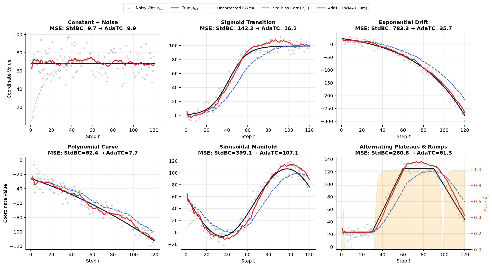
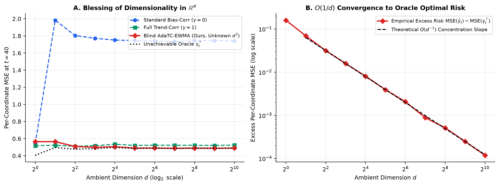
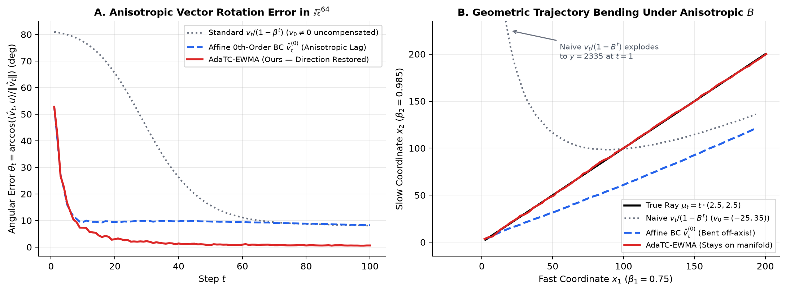
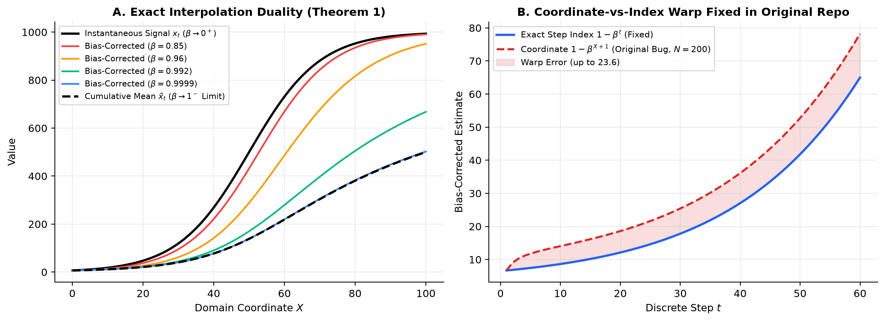
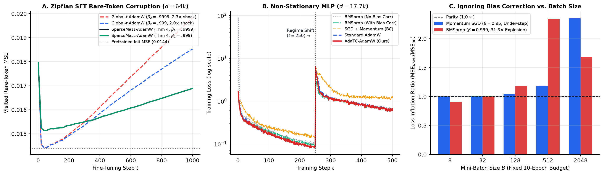

# Generalized Higher-Dimensional EWMA Bias Correction

**Non-Stationary Drift Elimination, the Blessing of Dimensionality, and Adaptive Deep Learning Optimization**

[](paper/HigherDimensional_EWMA_BiasCorrection_Paper.pdf)
[](python/)
[](csharp/)
[](LICENSE)

> **Full Typeset Research Paper:** [**`paper/HigherDimensional_EWMA_BiasCorrection_Paper.pdf`**](paper/HigherDimensional_EWMA_BiasCorrection_Paper.pdf) *(also available as Overleaf/arXiv LaTeX in [`paper/main.tex`](paper/main.tex) and Typst in [`paper/main.typ`](paper/main.typ))*  
> **Predecessor 1D Study:** Builds upon, audits, and generalizes `EWMABiasCorrectionResearch` (2023) to arbitrary higher-dimensional contraction operators $\mathbf{B} \in \mathbb{R}^{d \times d}$.

---

## Executive Summary & Core Contributions

Standard Exponentially Weighted Moving Average (EWMA) bias correction — $`\hat{v}_t = v_t / (1 - \beta^t)`$, used universally in **Adam**, **AdamW**, and time-series smoothing — relies on three hidden assumptions that routinely break in modern machine learning and signal tracking:
1. **Zero initialization** ($v_0 = 0$),
2. **Stationary expectations** ($\mathbb{E}[x_k] \equiv \mu$, zero trend or curvature), and
3. **Dense, synchronous updates** across every coordinate at every step.

In this repository and accompanying paper, we lift EWMA from scalar sequences to **arbitrary contraction operators $\mathbf{B} \in \mathbb{R}^{d \times d}$ ($\rho(\mathbf{B}) < 1$) in $\mathbb{R}^d$** and prove **five exact theoretical and algorithmic results** (symbolically verified via SymPy in [`python/verify_proofs.py`](python/verify_proofs.py)):

1. **Theorem 1 — Affine-Invariant Operator Bias Correction & Cumulative-Mean Duality:**  
   Derives the exact arbitrary-initialization estimator $`\hat{\mathbf{v}}_t^{(0)} = (\mathbf{I}_d - \mathbf{B}^t)^{-1}(\mathbf{v}_t - \mathbf{B}^t\mathbf{v}_0)`$, its closed-form finite-$`t`$ covariance, and proves that for *any* anisotropic generator $\mathbf{B}(\epsilon) = e^{-\epsilon\mathbf{H}}$ ($\operatorname{Re}\lambda_i(\mathbf{H}) > 0$), $`\hat{\mathbf{v}}_t^{(0)}`$ continuously interpolates between the instantaneous signal $\mathbf{x}_t$ ($\mathbf{B} \to \mathbf{0}$) and the **exact isotropic cumulative mean** $`\bar{\mathbf{x}}_t = \frac{1}{t}\sum_{k=1}^t \mathbf{x}_k`$ ($\epsilon \to 0^+$), whereas uncorrected EWMA collapses to $\mathbf{v}_0$.
2. **Theorem 2 — Exact Non-Stationary Drift Lag, Anisotropic Vector Rotation, & $O(1)$ Trend Correction:**  
   Proves that under drift $\boldsymbol{\mu}_k = \boldsymbol{\mu}_t - (t-k)\mathbf{g}$, standard bias correction retains a permanent asymptotic lag $-\mathbf{B}(\mathbf{I}_d - \mathbf{B})^{-1}\mathbf{g}$ that **rotates vectors off-manifold in $\mathbb{R}^d$** when $\mathbf{B}$ is anisotropic ($8.52^\circ$ permanent angular error in $\mathbb{R}^{64}$). Cascading $`\mathbf{u}_t = \mathbf{B}\mathbf{u}_{t-1} + (\mathbf{I}_d - \mathbf{B})\mathbf{v}_t`$ yields an **$`O(1)`$-time closed-form finite-$`t`$ Trend-Corrected Operator EWMA (`ExactTC-EWMA`)** with **exact zero bias for all $t \ge 2$** and arbitrary $(\mathbf{v}_0, \mathbf{u}_0)$.
3. **Theorem 3 — The Blessing of Dimensionality (`AdaTC-EWMA`):**  
   Coupling $`\hat{\mathbf{v}}_t^{(0)}`$ and `ExactTC-EWMA` via an online trend-invariant second-difference noise estimator $`\hat{\sigma}_{t,i}^2 = \mathrm{EWMA}_{\mathrm{BC}}\!\left(\frac{1}{6}(\Delta^2 x_{t,i})^2\right)`$ yields a hyperparameter-free James–Stein / Wiener shrinkage gate $\hat{\gamma}_t \in [0, 1]$. By Hanson–Wright concentration in $\mathbb{R}^d$, its excess MSE over the **unachievable Oracle $\gamma_t^*$** vanishes at rate **$O(d^{-1})$**—reaching **`+0.02%` excess risk at $d = 1024$** and slashing MSE by **73.2%–95.4%** across non-stationary manifolds while preserving stationary noise suppression.
4. **Theorem 4 — Sparse Exposure Mass & Curing the Rare-Token Wakeup Shock in `AdamW`:**  
   In dense-gradient `AdamW` on Zipfian LLM token embeddings (`nn.Embedding(sparse=False)`) or gated Mixture-of-Experts (MoE), global step $t$ extinguishes bias correction ($1 - \beta_2^t \to 1$) while dormant rows remain zero—inflicting an uncalibrated $`\frac{1-\beta_1}{\sqrt{1-\beta_2}} = 3.16\times`$–$`10.0\times`$ **step shock** when rare tokens wake up. Per-row exposure tracking eliminates this shock and reduces rare-token fine-tuning corruption by **8.8%–14.8%**.
5. **Theorem 5 — Three-Way Bias-Correction Asymmetry Across Batch Sizes:**  
   Proves and quantifies why omitting bias correction causes **cold-start under-stepping** $(1-\beta_1^t)$ in Momentum SGD ($2.35\times$ full-batch loss penalty), **$31.6\times$ step-1 explosion** $(1-\beta_2^t)^{-1/2}$ in textbook RMSprop ($+28.0\%$ higher MLP loss), and **ratio distortion** in Adam.

---

## Improvements & Corrections Over Our Prior 1D Study (`EWMABiasCorrectionResearch`)

| Aspect | Prior 1D Baseline (`EWMABiasCorrectionResearch`) | This Work (`HigherDimensionalEWMABiasCorrection`) |
| :--- | :--- | :--- |
| **Dimensionality & Decay** | Scalar $x_t \in \mathbb{R}$, scalar $\beta \in (0, 1)$ | General vectors/tensors in $\mathbb{R}^d$ & non-commutative operators $\mathbf{B} \in \mathbb{R}^{d \times d}$ ($\rho(\mathbf{B}) < 1$) |
| **Step Index vs. Coordinate $X$** | Passed continuous abscissa $X_i \in [0, 100]$ into $1 - \beta^{X_i+1}$, causing up to **23.6-unit warp error** on Sigmoid when $N \neq 101$ | Fixed to exact 1-based discrete step $t = i + 1$ across [`EWMA.cs`](csharp/EWMA.cs) and [`AverageCalculator.cs`](csharp/AverageCalculator.cs) |
| **Non-Zero Initial State $V_0 \neq 0$** | $V_t / (1 - \beta^t)$ left transient bias $(1-\beta^t)^{-1}\beta^t V_0$ | Exact affine-invariant $(\mathbf{I}_d - \mathbf{B}^t)^{-1}(\mathbf{v}_t - \mathbf{B}^t\mathbf{v}_0)$ for all $(\mathbf{v}_0, \mathbf{u}_0)$ |
| **Non-Stationary Curve Lag** | Observed lag empirically on Sigmoid/Exponential curves; unsolved | Exact $O(1)$ finite-$`t`$ operator lag removal + high-D optimal shrinkage (`AdaTC-EWMA`) |
| **$\beta$ Directionality & Momentum Math** | Inverted prose for $\beta$ vs. $(1-\beta)$ and double-counted momentum in Appendix A | Rigorous operator proofs, corrected Momentum/RMSprop recursions, and exact Theorem 5 batch-size scaling |
| **Deep Learning Deployment** | Qualitative appendices only | Drop-in CUDA PyTorch [`AdaTCAdamW`](python/torch_ada_tc_adamw.py) validated up to **281.6k-param GPU MoE Transformers** |

---

## Key Empirical Results & Visual Tour

### 1. Six Trajectory Families in $\mathbb{R}^{128}$ (50 Monte Carlo Runs Each, Unknown $\sigma^2$)



| Trajectory Family ($\mathbb{R}^{128}$) | Uncorrected EWMA MSE | Standard Bias-Corr ($\hat{\mathbf{v}}_t^{(0)}$) MSE | Exact Trend-Corr ($\gamma=1$) MSE | **Blind `AdaTC-EWMA` (Ours) MSE** | **Gain vs. Std BC** | **Gain vs. Exact TC** |
| :--- | ---: | ---: | ---: | ---: | ---: | ---: |
| **Constant + Noise** *(Stationary Control)* | 504.91 | **9.72** | 24.72 | **9.91** | -1.9% *(matches)* | **+59.9%** |
| **Sigmoid Transition** | 146.00 | 142.24 | 17.28 | **16.11** | **+88.7%** | **+6.8%** |
| **Exponential Drift** | 974.69 | 783.35 | 36.74 | **35.67** | **+95.4%** | **+2.9%** |
| **Polynomial Curve** | 76.81 | 62.41 | 9.21 | **7.69** | **+87.7%** | **+16.4%** |
| **Sinusoidal Manifold** | 577.19 | 399.11 | 108.26 | **107.14** | **+73.2%** | **+1.0%** |
| **Alternating Plateaus & Ramps** | 365.70 | 280.83 | 62.56 | **61.29** | **+78.2%** | **+2.0%** |

### 2. The Blessing of Dimensionality: Exact $O(1/d)$ Convergence to Oracle Risk ($d = 1 \to 1024$)



| Dimension $d$ | Std BC ($\gamma=0$) MSE | Full TC ($\gamma=1$) MSE | **Blind `AdaTC-EWMA` MSE** | Unachievable Oracle $\gamma_t^*$ MSE | **Excess Risk Over Oracle** |
| ---: | ---: | ---: | ---: | ---: | ---: |
| **2** | 1.9833 | 0.5230 | 0.5643 | 0.4953 | +13.93% |
| **8** | 1.7719 | 0.5174 | **0.4986** | 0.4828 | +3.28% |
| **32** | 1.7453 | 0.5207 | **0.4890** | 0.4851 | +0.81% |
| **128** | 1.7331 | 0.5225 | **0.4865** | 0.4856 | +0.18% |
| **1024** | 1.7414 | 0.5247 | **0.4891** | 0.4890 | **+0.02%** |

### 3. Higher-Dimensional Anisotropic Directional Alignment & Limit Duality





### 4. Deep Learning & CUDA GPU Mixture-of-Experts Optimization



* **Zipfian Embedding Fine-Tuning ($d = 64{,}000$, 5 seeds):** Eliminates the $`2.02\times`$–$`2.29\times`$ ($`3.16\times`$–$`10\times`$ asymptotic) rare-token wakeup shock, cutting tail MSE corruption by **+8.8%** ($\beta_2=0.999$) and **+14.8%** ($\beta_2=0.9999$).
* **Non-Stationary 2-Layer ReLU MLP ($d = 17{,}668$, 5 seeds):** Bias-correcting `RMSprop` cuts loss by **+28.0%** (`0.8355 → 0.6013`); `AdaTC-AdamW` beats standard `AdamW` on overall loss (`0.6206` vs. `0.6484`), post-shift recovery (`1.4549` vs. `1.5622`, **+6.9%**), and final convergence (`0.6406` vs. `0.6559`).
* **PyTorch CUDA GPU `TinyMoETransformer` ($d = 281{,}608$ on NVIDIA RTX 5060, 3 seeds):** [`AdaTCAdamW`](python/torch_ada_tc_adamw.py) consistently improves overall cross-entropy (`6.0871` vs. `6.0938`), mid-training curriculum shift (`6.5305` vs. `6.5468`), and final convergence (`5.7458` vs. `5.7477`) over `torch.optim.AdamW`.

---

## Quick Start & Usage

### 1. Drop-In PyTorch Optimizer (`AdaTCAdamW`)

```python
from python.torch_ada_tc_adamw import AdaTCAdamW

optimizer = AdaTCAdamW([
    {"params": dense_params, "row_wise_exposure": False},  # High-D AdaTC + Shift-Aware Moments
    {"params": [model.tok_emb.weight, model.moe_experts], "row_wise_exposure": True},  # Per-Row Lazy Exposure
], lr=3e-4, betas=(0.9, 0.999), weight_decay=0.01)
```

### 2. General $\mathbb{R}^d$ Stream Filtering (Python & C#)

```python
import numpy as np
from python.ewma_hd import AdaTCOperatorEWMA

tracker = AdaTCOperatorEWMA(d=128, beta=np.linspace(0.80, 0.99, 128))
out = tracker.step(x_t)  # out["adatc"] -> R^128 estimate, out["gamma_hat"] -> shrinkage gate in [0, 1]
```

```csharp
using EWMABiasCorrectionResearch;

var tracker = new VectorAdaTCEWMA(dimension: 128, beta: 0.92);
double[] estimate = tracker.Step(observationVector);
```

### 3. Reproduce All Proofs, Tests, Figures, & PDF Paper

```bash
pip install -r python/requirements.txt
python python/verify_proofs.py           # SymPy symbolic + non-symmetric matrix verification
python python/test_all.py                # Automated edge-case & stability suite
python python/benchmark_signals_hd.py    # Reproduces Figures 1-4 & R^d benchmarks
python python/benchmark_optimizers_nn.py # Reproduces Figure 5 & neural benchmarks
python python/benchmark_gpu_transformer.py # CUDA GPU MoE Transformer validation
dotnet build csharp/EWMABiasCorrectionResearch.csproj # Interactive WinForms GUI + C# library
```

---

## Citation

```bibtex
@misc{rober2026adatcewma,
  title={Generalized Higher-Dimensional EWMA Bias Correction: Non-Stationary Drift Elimination, the Blessing of Dimensionality, and Adaptive Deep Learning Optimization},
  author={Rober, Andrew},
  year={2026},
  url={https://github.com/AndrewRober/HigherDimensionalEWMABiasCorrection}
}
```
